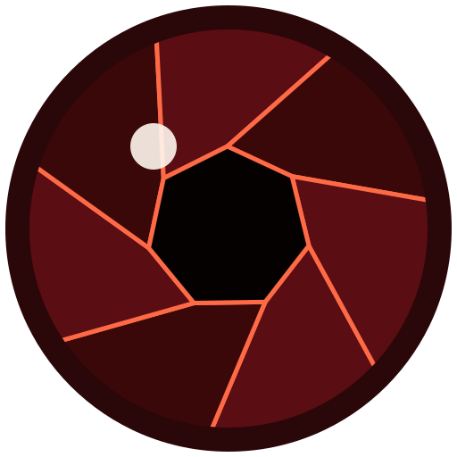

<p align="center"></p>

# Visual Radiometry Toolkit

by Ties Harder, Felix Seegräber and [James Pritts](https://prittjam.github.io/)

Julia packages for radiometric camera models: what decides how much light a
pixel collects (vignetting, aperture, focus, sensor response), as types that
lift the cameras of the
[Visual Geometry Toolkit](https://visualgeometrytoolkit.github.io). Radiometry
lifts geometry: the toolkit depends on the Visual Geometry Toolkit and follows
its conventions; nothing there depends on it. The camera model is that of
[Real Cameras are Radiometric](https://arxiv.org/abs/2611.25265).

**Under construction.** The packages are skeletons at a placeholder version
and are not in a registry.

This repository is a Julia workspace and the toolkit's site in one. Each
package directory is a separately registered package with its own version,
tests and documentation; `site/` is the landing page and documentation portal
served at <https://visualradiometrytoolkit.github.io>.

| Package | Role | Docs |
|---|---|---|
| [VisualRadiometryToolkitCore](VisualRadiometryToolkitCore) | The types of a radiometric camera: a geometric camera and its radiometric parts, each with an absent default that compiles away | [docs](https://visualradiometrytoolkit.github.io/VisualRadiometryToolkitCore/) |
| [VisualRadiometryToolkitIO](VisualRadiometryToolkitIO) | File formats: the radiometric types as self-describing files, in the Visual Geometry Toolkit's envelope | [docs](https://visualradiometrytoolkit.github.io/VisualRadiometryToolkitIO/) |

| Directory | What |
|---|---|
| [site](site) | The landing page, its icon tooling and the documentation portal |
| [ci](ci) | Workspace tooling: the registration lint, the agent-docs policy, the affected-package planner |
| [docs/design](docs/design) | Design notes: the [inventory](docs/design/inventory.md) of what moves here and in which order |

## Working in the repository

```bash
git clone https://github.com/VisualRadiometryToolkit/visualradiometrytoolkit.github.io
cd visualradiometrytoolkit.github.io
git config core.hooksPath .githooks
julia --project=. -e 'using Pkg; Pkg.instantiate()'
julia --project=VisualRadiometryToolkitCore -e 'using Pkg; Pkg.test()'
```

Julia 1.13. [CLAUDE.md](CLAUDE.md) lists the commands and the rules (among
them the privacy boundary: the repository is public, and nothing unpublished
enters it); [RELEASING.md](RELEASING.md) states how packages are released.

To preview the landing page: `python -m http.server` in `site/`, then open
<http://localhost:8000>. `site/icons/` is generated (`cd site/tools && pixi run
icons && pixi run social-card`).

## Citing

```bibtex
@article{harder2026radiometric,
  author        = {Harder, Ties and Seegr{\"a}ber, Felix and Nakath, David and
                   Sauer, Hendrik and K{\"o}ser, Kevin and Pritts, James},
  title         = {Real Cameras are Radiometric},
  journal       = {arXiv preprint arXiv:2611.25265},
  year          = {2026},
  eprint        = {2611.25265},
  archivePrefix = {arXiv},
  primaryClass  = {cs.CV},
}
```

## License

MIT. See [LICENSE](LICENSE) and [AUTHORS.md](AUTHORS.md).
